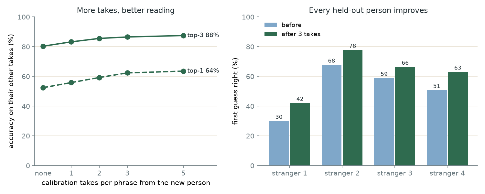

# Personal calibration ("Teach it their lips"): spec for Computer C

**Goal:** the patient mouths each core phrase 3 times (about 2 minutes), and the phone adapts the
model to their lips. Nothing leaves the phone.

## Results (core8, 4 people, each one held out as a stranger)

| | First guess right | Right one in top 3 | App speaks right away (70% threshold) |
|---|---|---|---|
| Shared model | 53% | 80.6% | 12% of takes, right 79% of those |
| **After 3 takes per phrase** | **62%** | **87.3%** | **33% of takes, right 84% of those** |

Every held-out person improved (first guess: 31→42%, 69→78%, 59→63%, 54→64%).
More takes help a little more (5 per phrase: 64% / 88%). Chart: `personal-calibration.png`.
Reproduce: `python silentvoice.py personal --set core8`.



## The math (already written: `web/src/engine/mlp.ts`)

The model is `h = relu(W1·x + b1)`, `logits = W2·h + b2`. Calibration keeps the hidden layer and
fine-tunes only the output layer (`W2`, `b2`; 8×128 + 8 numbers) on the patient's takes:

```
H   = hidden activations of the n calibration takes
lr  = 1 / (mean ‖h‖² + 1)
repeat 300 times:
  G  = (softmax(W·h + b) − onehot(y)) / n            per take
  W ← W − lr · (Gᵀ·H + 0.1 · (W − W2))               L2 pull back to the shared weights
  b ← b − 0.5 · (ΣG + 0.1 · (b − b2))
temperature ← model.personal.temperature             the adapted model is sharper; Python fits this
```

`golden.test.ts` checks the TS port against Python (`npm run test:engine`). 24 takes take ~44 ms on a laptop.
Settings come from `lipreader.json` → `personal: { takes, steps, lam_w, lam_b, temperature }`.

## What C builds

1. **Capture flow.** For each phrase in `model.classes`, ask for `model.personal.takes` (3) takes,
   interleaved (yes, no, …, yes, no, …) like `record` does. Reuse the Listen segmentation; for
   each take keep `features(segment)` (the same vector `predict` gets). Let the family member redo a take.
2. **Adapt.**
   ```ts
   import { personalize, applyPersonal, type Personal } from './engine/mlp'
   const personal = personalize(model, takes.map(t => t.x), takes.map(t => t.phraseId))
   localStorage.setItem('sv.personal', JSON.stringify(personal))          // ~10 KB
   ```
3. **Use it.** Wherever the model is loaded: `model = applyPersonal(model, saved)`. `applyPersonal`
   ignores a saved calibration if the model's phrases changed (new `lipreader.json`), so nothing breaks
   after a retrain; show "Teach it again" in that case.
4. **Badge.** "Personalized ✓" on the confidence bar when a calibration is applied; a "Reset" option.

Notes:
- Every phrase needs at least 1 take; 3 is the tested setting. Fewer still helps (1 per phrase: 56% / 83%).
- Wrap `localStorage` in try/catch (private mode). If it fails, keep the calibration in memory for the session.
